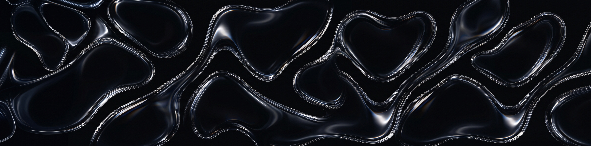
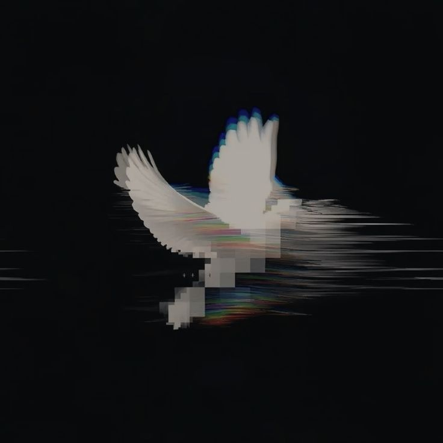

<!-- ═══════════════ PANORAMIC BANNER ═══════════════ -->

  

<!-- ═══════════════ TYPING (ROTATING LINES) ═══════════════ -->

  

 

<!-- ═══════════════ CAPSULE BUTTONS ═══════════════ -->

  
  
  
  
  

 

<!-- ═══════════════ TOP DIVIDER ═══════════════ -->

  

 

<!-- ═══════════════ MAIN CARD ═══════════════ -->

 <!-- -->

 

### `>_` Hey there! I'm Renzo 👋

**Software Engineer** · `Software Engineering, 2026` · `Lima, PE 🇵🇪`  
<code>status: shipping_code 🚀</code>

 

Quiet interfaces, fast code, zero noise. Building from **Peru**. 🌌

 

**🔭 Currently focusing on**
- **RenzoOS**: my personal portfolio, styled like an operating system, built with plain HTML, CSS and JavaScript.
- **TaskFlow**: a task manager with kanban boards, authentication and real-time sync.
- My tech lab revolves around **React**, **Node.js**, **PostgreSQL** and **AI automation**.

 

**💬 Ask me about**

<kbd>JavaScript</kbd> <kbd>React</kbd> <kbd>PostgreSQL</kbd> <kbd>Docker</kbd> <kbd>Git & GitHub</kbd> <kbd>Minimal UI</kbd>

 
<!-- ═══════════════ DIVIDER ═══════════════ -->

  

 
